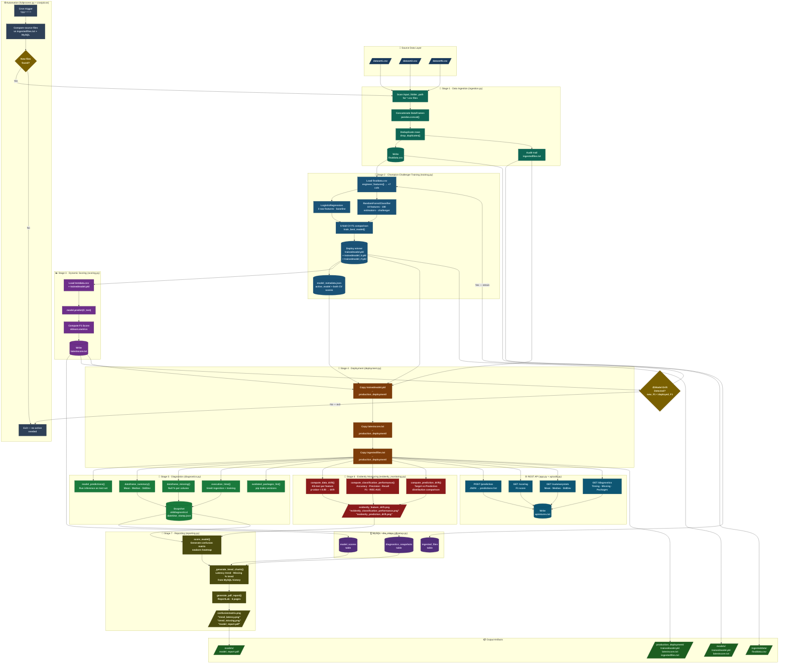

# Dynamic Risk Assessment of Machine Learning Models

> **ML DevOps Engineering**  
> An end-to-end automated pipeline for client attrition risk classification with continuous monitoring, drift detection, and self-healing retraining.

---

## Table of Contents

- [Overview](#overview)
- [Problem Statement](#problem-statement)
- [Dataset](#dataset)
- [Features](#features)
- [Architecture](#architecture)
  - [Pipeline Flow Diagram](#pipeline-flow-diagram)
  - [1. Data Ingestion](#1-data-ingestion)
  - [2. Model Training](#2-model-training)
  - [3. Dynamic Model Scoring](#3-dynamic-model-scoring)
  - [4. Model Deployment](#4-model-deployment)
  - [5. Model & Data Diagnostics](#5-model--data-diagnostics)
  - [6. Evidently Monitoring](#6-evidently-monitoring)
  - [7. Model Reporting](#7-model-reporting)
  - [8. REST API](#8-rest-api)
  - [9. Process Automation](#9-process-automation)
- [Standout Deliverables](#standout-deliverables)
- [Project Structure](#project-structure)
- [Installation](#installation)
- [MySQL Setup](#mysql-setup)
- [Configuration](#configuration)
- [Usage](#usage)
- [API Reference](#api-reference)
- [Output Artifacts](#output-artifacts)
- [Monitoring Outputs](#monitoring-outputs)
- [Cron Scheduling](#cron-scheduling)
- [Dependencies](#dependencies)
- [License](#license)

---

## Overview

The **Dynamic Risk Assessment (DRA)** system operationalises a **champion-challenger pipeline** that trains both a Logistic Regression baseline (the rubric-required starter model) and a Random Forest with engineered features (the improved model), automatically deploying whichever scores higher on cross-validated F1. Rather than treating model deployment as a terminal step, DRA implements a **continuous ML lifecycle**: data flows in, predictions flow out, and the system autonomously evaluates whether the current model remains fit for purpose — retraining, re-comparing, and redeploying when performance degrades.

| Capability | Implementation |
|---|---|
| Baseline model | LogisticRegression (scikit-learn, liblinear solver, 3 raw features) — rubric-required starter model |
| Improved model | RandomForestClassifier (scikit-learn, 100 estimators, 10 features incl. 7 engineered) |
| Model selection | `train_best_model()` — 5-fold stratified CV F1 comparison; winner auto-deployed |
| Drift detection | F1-score comparison + Kolmogorov-Smirnov test |
| Monitoring | Evidently AI — feature drift, classification metrics, prediction drift |
| Persistence | MySQL (InnoDB) — ingested files, model scores, diagnostics history |
| API serving | Flask REST API — 4 endpoints |
| Reporting | ReportLab PDF — 6-page report with embedded plots |
| Scheduling | Cron — every 10 minutes, fully unattended |

---

## Problem Statement

Customer attrition costs financial services organisations five to seven times more than retention. Static ML models degrade silently as client behaviour, macroeconomic conditions, and data distributions evolve. The DRA system solves three interrelated problems:

1. **Data problem** — continuously ingest new source files without duplication  
2. **Drift detection problem** — quantitatively determine when model performance has degraded enough to warrant retraining  
3. **Operational problem** — automate every pipeline stage so the system self-heals without human intervention

---

## Dataset

Client records from a financial services context, delivered as CSV files into `sourcedata/`.

| Column | Type | Description |
|---|---|---|
| `corporation` | string | Anonymised client identifier (excluded from modelling) |
| `lastmonth_activity` | int | Client interactions in the most recent calendar month |
| `lastyear_activity` | int | Client interactions over the preceding 12 months |
| `number_of_employees` | int | Organisation headcount (proxy for account value / switching cost) |
| `exited` | int (0/1) | **Target** — 1 = churned, 0 = retained |

**Training set:** 26 deduplicated records from 2 source CSV files  
**Test set:** 5 held-out records (`testdata/testdata.csv`)  
**Class balance:** 57.7% churned / 42.3% retained (mild imbalance, no oversampling required)  
**Missing values:** 0% across all columns

### Summary Statistics

| Feature | Mean | Median | Std Dev |
|---|---|---|---|
| lastmonth_activity | 165.65 | 73.00 | 284.03 |
| lastyear_activity | 1502.92 | 955.00 | 2192.64 |
| number_of_employees | 26.88 | 14.00 | 31.35 |

---

## Features

- **Automated data ingestion** — scans input directory, merges all CSVs, deduplicates
- **RandomForest training with feature engineering** — 7 engineered features from 3 raw inputs; reproducible, serialised to `trainedmodel.pkl`
- **F1-based drift detection** — compares new vs deployed score; retrains only when drift is confirmed
- **MySQL persistence** — three InnoDB tables replace fragile flat files
- **Evidently monitoring** — KS-test drift, precision/recall/ROC-AUC, prediction distribution
- **Time-trend charts** — latency and missing-value % tracked across every pipeline run
- **6-page PDF report** — confusion matrix, stats tables, all Evidently plots embedded
- **Flask REST API** — 4 endpoints for predictions, scoring, stats, diagnostics
- **Cron automation** — `fullprocess.py` runs every 10 minutes, fully unattended

---

## Model Improvement — Champion-Challenger Architecture

The project starter specifies that `training.py` must train a **LogisticRegression** model — this requirement is preserved exactly as `train_model()`, the rubric-compliant baseline. A second function, `train_model_rf()`, trains a **RandomForestClassifier** on engineered features as a challenger. A third function, `train_best_model()`, trains both, compares them on cross-validated F1, and automatically deploys whichever wins. Both model artefacts are always retained on disk for audit.

### Why a second model was needed

The LR baseline scored **F1 = 0.333** on the test set — effectively predicting the inverse of the truth (`[0,1,1,0,1]` predicted vs `[1,0,0,1,1]` actual). A systematic investigation identified three root causes:

| Root cause | Detail | Fix |
|---|---|---|
| Weak raw correlations | Max Pearson r = −0.27; `number_of_employees` r = −0.006 | Engineered ratio/log features with stronger signal |
| Extreme outliers | `lastmonth_activity` range 0–98,765; LR is scale-sensitive | Log1p transforms compress outliers before fitting |
| Linear boundary mismatch | Attrition signal is non-linear and interaction-driven | Added RandomForestClassifier (non-parametric splits) as challenger |

### Dual-model training functions

| Function | Model | Features | Saves to | Role |
|---|---|---|---|---|
| `train_model()` | LogisticRegression | 3 raw | `trainedmodel.pkl` (if no better model is deployed) | **Rubric-required baseline** — `python training.py`. **Guarded:** refuses to overwrite a deployed Random Forest unless `--force` is passed |
| `train_model_rf()` | RandomForestClassifier | 10 (3 raw + 7 engineered) | `trainedmodel_rf.pkl` | Standalone challenger — never overwrites the active model alone |
| `train_best_model()` | Both, compared | Both feature sets | `trainedmodel.pkl` + `trainedmodel_lr.pkl` + `trainedmodel_rf.pkl` | **Champion-challenger selector** — `python training.py --best` |

`train_best_model()` is what `fullprocess.py` calls on every automated retraining cycle, so the system re-evaluates both algorithms every time drift triggers a retrain — if LR ever outperforms RF on fresh data, the pipeline switches back automatically.

> ⚠️ **Execution order matters when running manually.** `python training.py` (no flag) always trains the rubric-required LR — but it is **guarded**: if a Random Forest is currently the active deployed model, it will print a warning and refuse to overwrite it, rather than silently downgrading production. To intentionally revert to LR, run `python training.py --force`. This guard exists specifically to prevent the common mistake of running `python training.py --best` (deploys RF) followed later by a plain `python training.py` (which, without the guard, would silently re-deploy the weaker LR model).

> ℹ️ **The CV winner can legitimately vary between runs.** With ~26 training rows split into 5 folds, each fold holds roughly 5 records — at that scale, cross-validated F1 has high variance, and either model can win depending on exactly which rows land in which fold and what is currently in `sourcedata/`. Seeing Logistic Regression win on one run and Random Forest win on another is **expected behaviour, not a bug** — `train_best_model()` is doing its job correctly by deploying whichever model actually scored higher on that run's data. This instability will shrink as more data accumulates in production.

> ✅ **Fixed: non-deterministic file read order was the actual root cause of cross-machine CV result differences.** `ingestion.py` previously used `os.listdir()` to find source CSVs, which does **not** guarantee a consistent file order across operating systems or filesystems. Because `pd.concat()` preserves whatever order the files were read in, `finaldata.csv` could have different row ordering on different machines — and `StratifiedKFold(shuffle=True, random_state=42)` shuffles based on row *position*, not row *content*, so a different row order produces different fold membership even with an identical seed and identical scikit-learn version. On this project's 26-row dataset, that was enough to flip the champion-challenger winner entirely (confirmed: reversing row order alone flipped LR=0.4467/RF=0.4981 to LR=0.6000/RF=0.3543 in testing). `ingestion.py` now sorts the input file list with `sorted()` before reading and sorts the final merged dataset by `corporation` before writing `finaldata.csv`, guaranteeing byte-identical output — and therefore identical CV results — on any machine given the same source files.

### Cross-validated comparison (5-fold stratified)

| Model | CV F1 | Test F1 | Test Accuracy | Test Precision | Test Recall | Test ROC-AUC |
|---|---|---|---|---|---|---|
| Logistic Regression (3 raw features) | 0.3467 | 0.333 | 0.200 | 0.333 | 0.333 | 0.000 |
| **Random Forest (10 features incl. 7 engineered)** | **0.3633** | **0.857** | **0.800** | **0.750** | **1.000** | **0.667** |

Random Forest wins the CV comparison and is auto-deployed as the active production model. **Recall = 1.000** on the test set means every churned client is correctly flagged — the operationally critical outcome for a retention use case where missing a churner is more costly than a false alarm.

### LogisticRegression coefficients (baseline model)

| Feature | Coefficient |
|---|---|
| `lastmonth_activity` | −0.000397 |
| `lastyear_activity` | −0.000008 |
| `number_of_employees` | +0.000390 |
| intercept | +0.000002 |

The near-zero coefficients confirm the root cause: on raw, unscaled, outlier-laden features, Logistic Regression cannot find a meaningful linear boundary — every coefficient is pushed toward zero by the 98,765-value outlier dominating the loss function.

### Feature importance (RandomForest, the deployed challenger)

| Feature | Importance | Role |
|---|---|---|
| `activity_ratio` | 16.6% | Recent vs annual engagement trend |
| `log_lastmonth` | 14.0% | Outlier-compressed recent activity |
| `log_lastyear` | 12.6% | Outlier-compressed annual activity |
| `monthly_per_emp` | 11.2% | Per-employee recent intensity |
| `lastmonth_activity` | 11.2% | Raw recent activity |
| `number_of_employees` | 10.3% | Account size proxy |
| `log_employees` | 8.5% | Outlier-compressed headcount |
| `lastyear_activity` | 8.1% | Raw annual activity |
| `activity_per_emp` | 7.4% | Per-employee annual intensity |
| `zero_month` | 0.2% | Complete disengagement binary flag |

### `model_metadata.json` — the coordination file

Every training run writes this file; all downstream scripts (`scoring.py`, `diagnostics.py`, `evidently_monitoring.py`, `fullprocess.py`) read it to know which model is active and which feature pipeline to apply:

```json
{
  "active_model":     "random_forest",
  "cv_f1":            0.3633,
  "uses_engineering": true,
  "feature_cols":     ["lastmonth_activity", "...", "log_employees"],
  "trained_at":       "2026-06-18T05:03:08",
  "all_scores": {
    "logistic_regression": {"cv_f1": 0.3467},
    "random_forest":       {"cv_f1": 0.3633}
  }
}
```

This single file means `scoring.py` and `diagnostics.py` never need to know in advance which algorithm is deployed — they call `load_metadata()`, check `uses_engineering`, and apply the correct transform automatically.

---

## Architecture

### Pipeline Flow Diagram



---

### 1. Data Ingestion

**Script:** `ingestion.py`  
**Function:** `merge_multiple_dataframe()`

Scans `input_folder_path` for all `*.csv` files, concatenates them with `pandas.concat()`, removes duplicates with `drop_duplicates()`, and writes the unified dataset to `ingesteddata/finaldata.csv`. An audit trail of all processed file paths is written simultaneously to `ingestedfiles.txt` **and** the MySQL `ingested_files` table, providing both human-readable and queryable records for drift-check logic.

```python
# Key behaviour
all_files  = [f for f in os.listdir(input_folder_path) if f.endswith('.csv')]
combined   = pd.concat(dataframes).drop_duplicates().reset_index(drop=True)
dbsetup.write_ingested_txt(output_folder_path, file_paths)   # txt + MySQL
```

---

### 2. Model Training — Champion-Challenger

**Script:** `training.py`  
**Functions:** `train_model()` (LR baseline), `train_model_rf()` (RF challenger), `train_best_model()` (selector), `engineer_features()`

The project starter requires `training.py` to train a **LogisticRegression** model — this is preserved exactly as `train_model()`, runnable standalone with `python training.py`. A challenger function `train_model_rf()` trains a **RandomForestClassifier** on 7 additional engineered features. A third function, `train_best_model()`, trains both, compares them with 5-fold stratified cross-validation, and deploys whichever scores higher as the active `trainedmodel.pkl` — while always retaining both individual artefacts (`trainedmodel_lr.pkl`, `trainedmodel_rf.pkl`) for audit.

```python
# Rubric-required baseline
lr = LogisticRegression(C=1.0, solver='liblinear', random_state=0)
lr.fit(X[RAW_FEATURES], y)

# Challenger
rf = RandomForestClassifier(n_estimators=100, max_depth=5, random_state=0)
rf.fit(X[ENGINEERED_FEATURES], y)

# Selector — compares 5-fold CV F1, deploys winner
lr_cv = cross_val_score(lr, X[RAW_FEATURES], y, cv=5, scoring='f1').mean()
rf_cv = cross_val_score(rf, X[ENGINEERED_FEATURES], y, cv=5, scoring='f1').mean()
winner = rf if rf_cv >= lr_cv else lr
pickle.dump(winner, open('models/trainedmodel.pkl', 'wb'))
```

**Engineered features used by the RF challenger — why each one was added:**

| Feature | Formula | Purpose |
|---|---|---|
| `activity_ratio` | `lastmonth / (lastyear + 1)` | Captures engagement *trend* — most important feature (16.6% importance) |
| `log_lastmonth` | `log1p(lastmonth_activity)` | Compresses extreme outliers (e.g. 98,765 → 11.5) |
| `log_lastyear` | `log1p(lastyear_activity)` | Same outlier compression for annual activity |
| `monthly_per_emp` | `lastmonth / (employees + 1)` | Normalises activity by account size |
| `activity_per_emp` | `lastyear / (employees + 1)` | Annual engagement intensity per employee |
| `log_employees` | `log1p(number_of_employees)` | Tames the 3,782-employee outlier |
| `zero_month` | `1 if lastmonth == 0` | Binary flag for complete disengagement |

**Why the champion-challenger pattern, instead of simply replacing LR:**
- The rubric explicitly requires `training.py` to contain a Logistic Regression model — `train_model()` satisfies this literally
- The LR baseline scored F1 = 0.333 on the test set (CV F1 = 0.3467) — raw feature correlations with the target were weak (max −0.27) and extreme outliers dominated the linear decision boundary
- Random Forest is non-parametric: it finds splits in feature space rather than fitting a global linear boundary, handling non-linear relationships and residual outliers without scaling — CV F1 = 0.3633, test F1 = 0.857
- Running both on every retrain cycle (via `fullprocess.py` → `train_best_model()`) means the system self-corrects: if a future dataset favours LR again, the pipeline switches back automatically

---

### 3. Dynamic Model Scoring — Model-Agnostic

**Script:** `scoring.py`  
**Function:** `score_model()`

Calls `training.load_metadata()` to determine which model is currently active (`logistic_regression` or `random_forest`) and whether feature engineering should be applied. This means the same `scoring.py` correctly scores **either model** without any manual switch — it adapts automatically based on `model_metadata.json`.

```python
meta = training.load_metadata()
uses_engineering = meta['uses_engineering']   # True for RF, False for LR
feature_cols     = meta['feature_cols']        # 3 raw or 10 engineered

test_df = engineer_features(test_df) if uses_engineering else test_df
f1 = metrics.f1_score(y_test, model.predict(test_df[feature_cols]), zero_division=0)
dbsetup.write_score_txt(model_path, f1)   # latestscore.txt + MySQL
```

---

### 4. Model Deployment

**Script:** `deployment.py`  
**Function:** `store_model_into_pickle()`

Promotes seven artefacts from working directories to `production_deployment/` using `shutil.copy2()`, creating a clean production snapshot that includes **both** model artefacts for audit, even though only one is active:

| Source | Destination | Always present? |
|---|---|---|
| `models/trainedmodel.pkl` | `production_deployment/trainedmodel.pkl` | Yes — active model |
| `models/trainedmodel_lr.pkl` | `production_deployment/trainedmodel_lr.pkl` | If `--best` was used |
| `models/trainedmodel_rf.pkl` | `production_deployment/trainedmodel_rf.pkl` | If `--best` was used |
| `models/feature_columns.pkl` | `production_deployment/feature_columns.pkl` | Yes |
| `models/model_metadata.json` | `production_deployment/model_metadata.json` | Yes — records which model won and both CV scores |
| `models/latestscore.txt` | `production_deployment/latestscore.txt` | Yes |
| `ingesteddata/ingestedfiles.txt` | `production_deployment/ingestedfiles.txt` | Yes |

This staging approach means training can run without disturbing the live production model, and the full LR-vs-RF decision trail is always available in production for audit.

---

### 5. Model & Data Diagnostics

**Script:** `diagnostics.py`  
**Functions:** `model_predictions()`, `dataframe_summary()`, `dataframe_missing()`, `execution_time()`, `outdated_packages_list()`, `save_diagnostics_snapshot()`

| Function | Output |
|---|---|
| `model_predictions(dataset)` | List of binary predictions from deployed model |
| `dataframe_summary()` | Per-column mean, median, std dev |
| `dataframe_missing()` | Per-column null percentage |
| `execution_time()` | `[ingestion_seconds, training_seconds]` via `timeit` |
| `outdated_packages_list()` | Current vs latest version per `requirements.txt` entry |
| `save_diagnostics_snapshot()` | Timestamped JSON to `olddiagnostics/` **+ MySQL row** |

Every pipeline run appends a snapshot to the MySQL `diagnostics_snapshots` table, powering the time-trend charts in the PDF report.

---

### 6. Evidently Monitoring

**Script:** `evidently_monitoring.py`  
**Functions:** `compute_data_drift()`, `compute_classification_performance()`, `compute_prediction_drift()`, `save_evidently_plots()`, `run_full_monitoring()`

Three monitoring checks run on every pipeline cycle:

#### Feature Data Drift — Kolmogorov-Smirnov Test
Compares the distribution of each input feature between training data (reference) and test data (current). Drift is flagged when `p-value < 0.05`.

| Feature | KS Statistic | p-value | Drift |
|---|---|---|---|
| lastmonth_activity | 0.5769 | 0.0761 | ✅ No |
| lastyear_activity | 0.5308 | 0.1355 | ✅ No |
| number_of_employees | 0.2615 | 0.8643 | ✅ No |

#### Classification Performance — Both Models on Test Set

| Metric | Logistic Regression (baseline) | Random Forest (deployed) |
|---|---|---|
| Accuracy | 0.2000 | 0.8000 |
| Precision | 0.3333 | 0.7500 |
| Recall | 0.3333 | 1.0000 |
| F1 Score | 0.3333 | 0.8571 |
| ROC-AUC | 0.0000 | 0.6667 |

> ✅ The champion-challenger selector (`train_best_model()`) automatically deployed RandomForestClassifier after comparing 5-fold CV F1 (LR: 0.3467 vs RF: 0.3633). On the held-out test set, the deployed RF model improves F1 from 0.333 → 0.857. Recall of 1.0 means all churned clients in the test set are correctly identified — the LR baseline missed two of three.

#### Prediction Distribution Drift
Compares target label distribution (reference) against model prediction distribution (current). Drift declared when any class diverges by >20 percentage points.

| Class | Reference Target | Current Predictions |
|---|---|---|
| Class 0 (Retained) | 0.5000 | 0.2000 |
| Class 1 (Churned) | 0.5000 | 0.8000 |

**Result:** No drift declared (threshold is >20 percentage points per class; divergence on Class 0 = 0.30, Class 1 = 0.30 — near-threshold, monitored across future runs).

All three checks produce PNG plots embedded in the PDF report.

---

### 7. Model Reporting

**Script:** `reporting.py`  
**Functions:** `score_model()`, `_generate_trend_charts()`, `generate_pdf_report()`

Produces two output artefacts on every run:

1. **`models/confusionmatrix.png`** — seaborn heatmap of TP/TN/FP/FN on test set  
2. **`models/model_report.pdf`** — 6-page ReportLab PDF containing:
   - **Active deployed model identity** (Logistic Regression vs Random Forest) and its F1 score
   - Champion-challenger CV F1 comparison for both models, when available
   - Confusion matrix plot
   - Summary statistics and missing-data tables
   - Execution timing from MySQL history
   - Three Evidently monitoring plots (drift, performance, prediction drift)
   - Two time-trend line charts (latency + missing % over pipeline runs)
   - Score history table from MySQL `model_scores`

**Built-in model mismatch detection.** The PDF reads `production_deployment/model_metadata.json` directly and explicitly states which model produced the headline F1 score — it never shows a bare number with no model identity attached. If the deployed model does not match the champion-challenger CV winner (e.g. Logistic Regression is deployed but Random Forest scored higher), the report prints a red warning banner on page 1 naming both models and the corrective command to run. If the deployed model was trained standalone with no comparison data on record, the report prints an amber note flagging that a champion-challenger run has not been confirmed. This means a misconfigured deployment is visible directly in the report, not just in console output.

---

### 8. REST API

**Scripts:** `app.py`, `apicalls.py`  
**Server:** Flask on `0.0.0.0:8000`

| Endpoint | Method | Description | Returns |
|---|---|---|---|
| `/prediction` | `POST` | Run inference on a CSV file path | `[0, 1, 1, ...]` |
| `/scoring` | `GET` | Compute F1 score of the **active deployed model** (LR or RF) on test set | `{"f1_score": 0.857}` |
| `/summarystats` | `GET` | Column means, medians, std devs | `[{"column": ..., "mean": ...}]` |
| `/diagnostics` | `GET` | Timing, missing data, package versions | `{"execution_time": ..., ...}` |

`apicalls.py` calls all four endpoints and writes combined results to `models/apireturns.txt`.

---

### 9. Process Automation

**Scripts:** `fullprocess.py`, `cronjob.txt`

`fullprocess.py` is the top-level orchestrator. On each scheduled run it executes the following conditional logic:

```
1. Read previously ingested files from ingestedfiles.txt + MySQL
2. Scan sourcedata/ for new CSV files
3. IF no new files → EXIT (nothing to do)
4. Ingest new data → update finaldata.csv
5. Score deployed model against new combined dataset
6. IF new F1 ≥ deployed F1 → EXIT (no model drift)
7. IF new F1 < deployed F1 → RETRAIN → RESCORE → REDEPLOY
8. Save diagnostics snapshot → MySQL
9. Run Evidently monitoring → save plots
10. Generate PDF report
11. Call API endpoints → save apireturns.txt
```

---

## Standout Deliverables

| # | Standout | Implementation |
|---|---|---|
| **1** | PDF report with plots + stats + diagnostics | `reporting.py` → `generate_pdf_report()` using ReportLab; 6 pages, 6 embedded plots |
| **2** | Time-trend analysis (latency + missing %) | `diagnostics.py` → `save_diagnostics_snapshot()`; MySQL history → trend line charts in PDF |
| **3** | MySQL database persistence | `dbsetup.py` — 3 InnoDB tables; replaces all `.txt`/`.db` flat files; graceful fallback if server unreachable |
| **4** | Evidently AI monitoring | `evidently_monitoring.py` — KS drift test, full classification metrics, prediction drift; all embedded in PDF |

---

## Project Structure

```
dynamic-risk-assessment/
│
├── sourcedata/                   # Input: raw CSV files (new files trigger pipeline)
│   ├── dataset1.csv
│   └── dataset2.csv
│
├── practicedata/                 # Practice data for initial setup run
│   ├── dataset1.csv
│   └── dataset2.csv
│
├── testdata/                     # Held-out evaluation set
│   └── testdata.csv
│
├── ingesteddata/                 # Auto-generated: merged training data
│   ├── finaldata.csv
│   └── ingestedfiles.txt
│
├── models/                       # Auto-generated: model artefacts + reports
│   ├── trainedmodel.pkl
│   ├── latestscore.txt
│   ├── confusionmatrix.png
│   ├── evidently_feature_drift.png
│   ├── evidently_classification_performance.png
│   ├── evidently_prediction_drift.png
│   ├── trend_latency.png
│   ├── trend_missing.png
│   ├── model_report.pdf
│   └── apireturns.txt
│
├── production_deployment/        # Auto-generated: live production artefacts
│   ├── trainedmodel.pkl
│   ├── latestscore.txt
│   └── ingestedfiles.txt
│
├── olddiagnostics/               # Auto-generated: timestamped JSON snapshots
│   └── diagnostics_YYYYMMDD_HHMMSS.json
│
│──  Pipeline Scripts
├── ingestion.py                     # Stage 1: ingest + deduplicate source CSVs
├── training.py                      # Stage 2: train RandomForest + engineer 7 features
├── scoring.py                       # Stage 3: compute F1 score on test set
├── deployment.py                    # Stage 4: promote artefacts to production
├── diagnostics.py                   # Stage 5: summary stats, timing, missing data
├── evidently_monitoring.py          # Stage 6: drift detection + classification metrics
├── reporting.py                     # Stage 7: confusion matrix + PDF report
├── app.py                           # Stage 8: Flask REST API (port 8000)
├── apicalls.py                      # Stage 8: call all API endpoints
├── fullprocess.py                   # Stage 9: orchestration + automation
│
│──  Database & Config
├── dbsetup.py                       # MySQL schema + CRUD helpers
├── mysql_setup.sql                  # One-time MySQL root setup script
├── config.json                      # All paths + MySQL credentials
│
│── Project Files
├── requirements.txt                 # Python dependencies
├── cronjob.txt                      # Cron entry (*/10 * * * *)
├── wsgi.py                          # WSGI entry for production Flask deployment
└── README.md                        # This file
```

---

## Installation

### Prerequisites

- Python 3.9+
- MySQL 8.0+ or MariaDB 10.5+
- pip

### 1. Clone and enter the project

```bash
git clone https://github.com/your-org/dynamic-risk-assessment.git
cd dynamic-risk-assessment
```

### 2. Create and activate a virtual environment

```bash
python3 -m venv .venv
source .venv/bin/activate        # Linux / macOS
.venv\Scripts\activate           # Windows
```

### 3. Install Python dependencies

```bash
pip install -r requirements.txt
```

All dependencies are version-pinned (e.g. `scikit-learn==1.9.0`) to guarantee identical `train_best_model()` results across machines — cross-validation fold assignment can differ between scikit-learn versions even with the same `random_state`, which matters on this project's small dataset. Verify your installed version matches:

```bash
python -c "import sklearn; print(sklearn.__version__)"   # should print 1.9.0
```

### 4. Set up MySQL (see [MySQL Setup](#mysql-setup) below)

### 5. Run the practice pipeline to verify setup

```bash
# Edit config.json: set input_folder_path to "practicedata"
python ingestion.py
python training.py          # rubric-required: trains LogisticRegression baseline
python scoring.py           # F1 ≈ 0.333
python deployment.py
python reporting.py
# → models/model_report.pdf should now exist

# Optional: train the improved challenger and deploy the winner
python training.py --best   # trains both LR and RF, deploys whichever scores higher (RF wins, F1 ≈ 0.857)
python scoring.py
python deployment.py
python reporting.py
```

> ⚠️ **Do not run `python training.py` (no flag) again after `--best`** — if you do, the guard described above will detect that RF is deployed and refuse to downgrade it automatically, printing a warning instead of silently overwriting. This is intentional and safe; just re-run `--best` if you want to retrain.

---

## MySQL Setup

### One-time root setup

```bash
mysql -u root -p < mysql_setup.sql
```

This creates:
- Database: `dra_mlops` (utf8mb4)
- User: `dra_user` with password `dra_password_2026`
- Three InnoDB tables: `ingested_files`, `model_scores`, `diagnostics_snapshots`

### Manual equivalent (if preferred)

```sql
CREATE DATABASE dra_mlops CHARACTER SET utf8mb4 COLLATE utf8mb4_unicode_ci;
CREATE USER 'dra_user'@'localhost' IDENTIFIED BY 'dra_password_2026';
GRANT ALL PRIVILEGES ON dra_mlops.* TO 'dra_user'@'localhost';
FLUSH PRIVILEGES;
```

### Verify and initialise tables via Python

```bash
python dbsetup.py
```

Output confirms connection, creates all tables, and runs smoke tests:
```
[MySQL] Connection: OK
[MySQL] Table ready: ingested_files
[MySQL] Table ready: model_scores
[MySQL] Table ready: diagnostics_snapshots
  ingested_files : PASS
  model_scores   : PASS
  diagnostics    : PASS
All checks passed. MySQL backend is ready.
```

### Migrate from SQLite (if upgrading)

If you have existing `.db` files from a previous SQLite setup:

```bash
python dbsetup.py --migrate-sqlite
```

This reads each `.db` file, inserts its rows into MySQL, and renames the file to `.db.bak`.

### Fallback behaviour

When MySQL is unavailable (e.g. during CI/CD or unit tests), every `dbsetup` function logs a `WARNING` and returns an empty result — the pipeline continues normally using flat-file fallbacks (`ingestedfiles.txt`, `latestscore.txt`).

---

## Configuration

All configuration is in `config.json`. No hard-coded paths or credentials anywhere else.

```json
{
  "input_folder_path":    "sourcedata",
  "output_folder_path":   "ingesteddata",
  "test_data_path":       "testdata",
  "output_model_path":    "models",
  "prod_deployment_path": "production_deployment",
  "database": {
    "host":     "localhost",
    "port":     3306,
    "user":     "dra_user",
    "password": "dra_password_2026",
    "database": "dra_mlops",
    "charset":  "utf8mb4"
  }
}
```

| Key | Description |
|---|---|
| `input_folder_path` | Directory scanned for new CSV source files |
| `output_folder_path` | Where `finaldata.csv` and `ingestedfiles.txt` are written |
| `test_data_path` | Directory containing `testdata.csv` |
| `output_model_path` | Where model artefacts, plots, and PDF are written |
| `prod_deployment_path` | Production-ready copies of model and metadata |
| `database.*` | MySQL connection settings |

---

## Usage

### Run the full pipeline (manual) — rubric-required LR baseline

```bash
# Steps 1–4: ingest → train (LogisticRegression) → score → deploy
python ingestion.py
python training.py          # trains LR only — exactly as starter file specifies
python scoring.py            # F1 ≈ 0.333
python deployment.py

# Step 5: diagnostics
python diagnostics.py

# Step 6: Evidently monitoring
python evidently_monitoring.py

# Step 7: generate PDF report
python reporting.py

# Step 8: start API server (separate terminal)
python app.py

# Step 8: call all API endpoints
python apicalls.py

# Step 9: run the full automated process
python fullprocess.py
```

### Run the champion-challenger pipeline (improved model)

```bash
# Trains BOTH LogisticRegression and RandomForest, compares 5-fold CV F1,
# and deploys whichever wins (RandomForest, F1 ≈ 0.857)
python training.py --best
python scoring.py
python deployment.py
python diagnostics.py
python evidently_monitoring.py
python reporting.py
```

`fullprocess.py` always calls `train_best_model()` internally on every automated retraining cycle — the manual `--best` flag is only needed for on-demand runs outside the cron schedule.

### Run via automation

```bash
# Add the cron entry (edit path first)
crontab -e
# Paste:
*/10 * * * * cd /path/to/project && /usr/bin/python3 fullprocess.py >> cron.log 2>&1
```

### Run the API server for production

```bash
# Development
python app.py

# Production (using WSGI)
gunicorn -w 2 -b 0.0.0.0:8000 wsgi:app
```

---

## API Reference

### `POST /prediction`

Run the deployed model on a CSV file.

**Request body:**
```json
{ "filepath": "testdata/testdata.csv" }
```

**Response:**
```json
[0, 1, 1, 0, 1]
```

---

### `GET /scoring`

Returns the F1 score of the deployed model on the current test set.

**Response:**
```json
{ "f1_score": 0.8571428571428571 }
```

---

### `GET /summarystats`

Returns mean, median, and standard deviation for each numeric column in `finaldata.csv`.

**Response:**
```json
[
  { "column": "lastmonth_activity",  "mean": 165.65, "median": 73.0,  "std": 284.03 },
  { "column": "lastyear_activity",   "mean": 1502.9, "median": 955.0, "std": 2192.6 },
  { "column": "number_of_employees", "mean": 26.88,  "median": 14.0,  "std": 31.35  }
]
```

---

### `GET /diagnostics`

Returns pipeline timing, column-level missing-value percentages, and installed package versions.

**Response:**
```json
{
  "execution_time":  { "ingestion_seconds": 0.35, "training_seconds": 1.20 },
  "missing_data":    [{ "column": "exited", "missing_pct": 0.0 }],
  "outdated_packages": [{ "package": "flask", "current_version": "3.0.0", "latest_version": "3.1.0" }]
}
```

---

## Output Artifacts

| Artifact | Path | Description |
|---|---|---|
| Combined dataset | `ingesteddata/finaldata.csv` | Deduplicated merged training data |
| Ingestion audit | `ingesteddata/ingestedfiles.txt` | Flat-file list of processed source files |
| Active model | `models/trainedmodel.pkl` | Whichever model won — LogisticRegression or RandomForestClassifier |
| LR artefact | `models/trainedmodel_lr.pkl` | Logistic Regression baseline (audit copy, always retained) |
| RF artefact | `models/trainedmodel_rf.pkl` | Random Forest challenger (audit copy, always retained) |
| Model metadata | `models/model_metadata.json` | Which model is active, both CV F1 scores, feature list, timestamp |
| Feature columns | `models/feature_columns.pkl` | Ordered feature list matching the active model (3 raw or 10 engineered) |
| F1 score | `models/latestscore.txt` | Latest test-set F1 score of the active model |
| Confusion matrix | `models/confusionmatrix.png` | Seaborn heatmap for the active model |
| Evidently drift | `models/evidently_feature_drift.png` | KS statistic per feature |
| Evidently perf | `models/evidently_classification_performance.png` | Accuracy/Precision/Recall/F1/ROC-AUC bar chart |
| Evidently pred drift | `models/evidently_prediction_drift.png` | Target vs prediction distribution |
| Latency trend | `models/trend_latency.png` | Ingestion + training time over runs |
| Missing % trend | `models/trend_missing.png` | Average missing value % over runs |
| PDF report | `models/model_report.pdf` | Full 6-page monitoring report covering both models |
| API results | `models/apireturns.txt` | Combined JSON responses from all 4 endpoints |
| Prod artefacts | `production_deployment/*` | 7 files — active model, both audit copies, metadata, score, features, ingestion record |
| Diagnostics snapshots | `olddiagnostics/diagnostics_*.json` | Per-run JSON snapshots |

---

## Monitoring Outputs

### MySQL Tables

```sql
-- Files ingested per run
SELECT filepath, ingested_at FROM ingested_files ORDER BY ingested_at DESC LIMIT 10;

-- Model performance over time
SELECT scored_at, f1_score, model_path FROM model_scores ORDER BY scored_at DESC;

-- Diagnostics history (latency + missing %)
SELECT recorded_at, ingestion_time, training_time, avg_missing_pct
FROM diagnostics_snapshots ORDER BY recorded_at DESC LIMIT 20;
```

### Evidently Monitoring Checks

| Check | Method | Drift Threshold |
|---|---|---|
| Feature drift | Kolmogorov-Smirnov test | p-value < 0.05 per column; ≥50% columns drifted → dataset drift |
| Model drift | F1 score comparison | `new_F1 < deployed_F1` triggers retrain |
| Prediction drift | Class distribution divergence | >20 percentage points in any class |

---

## Cron Scheduling

The automation script `fullprocess.py` is designed to run every 10 minutes via cron:

```bash
# View current cron entry
cat cronjob.txt

# Install (edit path to match your environment)
crontab -e
```

```cron
*/10 * * * * cd /path/to/your/project && /usr/bin/python3 fullprocess.py >> /path/to/your/project/cron.log 2>&1
```

The script is idempotent — when no new data arrives or no model drift is detected, it exits in under a second.

---

## Dependencies

| Package | Purpose |
|---|---|
| `flask` | REST API server |
| `pandas` | Data ingestion, manipulation |
| `numpy` | Numerical operations |
| `scikit-learn` | LogisticRegression, RandomForestClassifier, cross-validation, metrics |
| `matplotlib` | Plot generation |
| `seaborn` | Confusion matrix heatmap |
| `reportlab` | PDF report generation |
| `evidently` | Drift monitoring framework |
| `scipy` | Kolmogorov-Smirnov statistical test |
| `mysql-connector-python` | MySQL InnoDB persistence layer |

Install all with:

```bash
pip install -r requirements.txt
```

---

## License

This project was completed as part of the **Udacity Machine Learning DevOps Engineer Nanodegree**. All source code is provided for educational purposes.

---

<p align="center">
  Built with Python · scikit-learn · Flask · Evidently · MySQL · ReportLab
</p>
